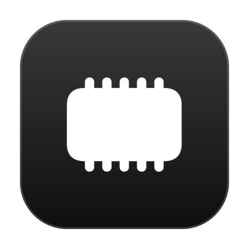

<div align="center">



# Give my ram back

**A macOS menu-bar utility that pauses idle heavy apps to give you back RAM and battery.**

[](https://github.com/infarmor/GiveMyRamBack/actions/workflows/ci.yml)


[](LICENSE)

[Русский](README.md)

</div>

---

A browser with fifty tabs, Slack, Discord and a couple of Electron apps you haven't touched in an hour keep holding gigabytes and burning CPU. **Give my ram back** pauses them with `SIGSTOP`: a stopped process uses no CPU at all, and macOS compresses or swaps its memory first. Switch to the app, click its window or its Dock icon, and it resumes instantly with `SIGCONT`, right where it was.

> The interface is available in English and Russian and follows your system language.

## Features

- **Idle timer per app** that ignores Mac sleep and clock changes. Per-app rules: *Auto*, *Fast*, *Protected*.
- **Pressure-aware**: timeouts shrink under memory pressure and on battery. An optional *only under memory pressure* mode leaves idle apps alone until RAM runs low, except background CPU hogs.
- **Leaves alone what you use**: the frontmost app, windows that are visible on screen, apps playing audio or using the mic, video, calls and downloads (power assertions), the clipboard owner, terminals, IDEs and system tools.
- **Instant wake** on Cmd+Tab, Dock, Mission Control, a click on a frozen window, a click on its Dock icon (with Accessibility permission), or the global **⌃⌥⌘U** shortcut.
- **Frozen windows are dimmed and labelled**, so they aren't mistaken for hung apps.
- **“Why?”** for every app: why it is paused, protected, or when and why it will be paused. Daily and weekly stats of RAM given back.
- **First-run introduction** that offers to protect your installed messengers, and a daily **update check** via GitHub that sends nothing about you.
- **Crash-safe**: freeze records are written before the first `SIGSTOP`, a fatal-signal handler resumes everything, and a watchdog process unfreezes all apps even if the utility is `kill -9`'d.
- **Light**: samples every 5 s while the UI is closed, about 0.5% of one core.

## Download

Grab `GiveMyRamBack-…-universal.zip` from the [latest release](https://github.com/infarmor/GiveMyRamBack/releases/latest) (Apple silicon + Intel, macOS 14+), unzip, and move the app to `/Applications`. The app is ad-hoc signed and not notarized, so clear the quarantine flag once:

```bash
xattr -dr com.apple.quarantine "/Applications/Give my ram back.app"
```

## Build

Requires macOS 14+ and Xcode 16 / Swift 6. Use `UNIVERSAL=1` for a fat binary.

```bash
git clone https://github.com/infarmor/GiveMyRamBack.git
cd GiveMyRamBack
./scripts/build_app.sh release
open "Give my ram back.app"
```

```bash
swift test
/usr/bin/log stream --predicate 'subsystem == "dev.givemyramback.app"' --level info
```

## License

[MIT](LICENSE)
