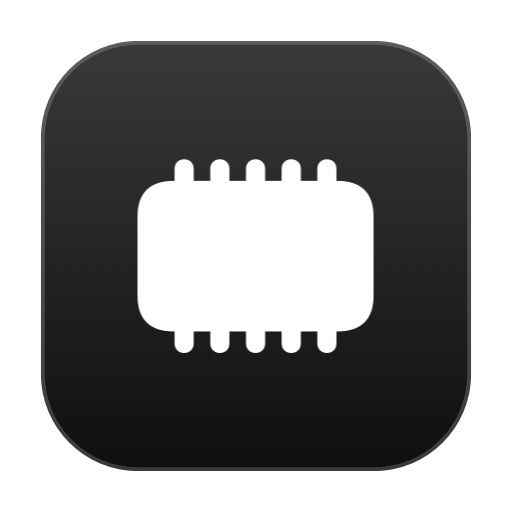
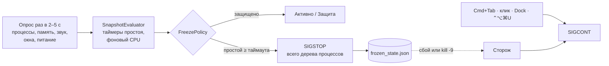

<div align="center">



# Give my ram back

**Утилита для строки меню macOS: ставит неактивные тяжёлые программы на паузу и возвращает память и заряд батареи.**

[](https://github.com/infarmor/GiveMyRamBack/actions/workflows/ci.yml)


[](LICENSE)

[English](README.en.md) · [Возможности](#возможности) · [Установка](#установка) · [Как это работает](#как-это-работает) · [Безопасность](#безопасность)

</div>

---

Браузер с полусотней вкладок, Slack, Discord, Figma и пара Electron-приложений, к которым вы не прикасались час, продолжают занимать гигабайты памяти и тратить процессор. **Give my ram back** замечает такие программы и ставит их на паузу (`SIGSTOP`). macOS охотнее сжимает и выгружает память остановленного процесса, а процессор он не тратит совсем. Стоит переключиться на программу, кликнуть по её окну или иконке в Dock, и она мгновенно продолжает работу (`SIGCONT`) с того же места.

## Возможности

### Автоматическая пауза
- **Таймер простоя** для каждой программы. Время, пока Mac спит, не считается, переводы часов тоже не сбивают отсчёт.
- **Правила** «Авто», «Быстро» и «Защита» для отдельных программ.
- **Ускорение при нехватке памяти**: в жёлтой зоне отсчёт идёт вдвое быстрее, в красной — вчетверо. При работе от батареи — тоже вдвое.
- **Режим «Только при нехватке памяти»**. Пока RAM хватает, пауза почти ничего не освобождает, а уведомления пропадают. В этом режиме программы ждут жёлтой зоны, а сразу на паузу встают только те, что нагружают процессор в фоне.
- **Фоновые сервисы** (node, демоны синхронизации и т.п.) — по вашему выбору, с предупреждением о рисках.

### Не трогает то, чем вы пользуетесь
- Активное окно и **окна, которые видно на экране**: если окно перекрыто меньше чем на 65%, программа не считается неактивной.
- Программы, которые **играют звук или пишут с микрофона** (CoreAudio).
- **Видео, звонки и загрузки**: всё, что не даёт Mac уснуть (IOKit power assertions).
- **Источник буфера обмена**, чтобы вставка в другой программе не зависала.
- Терминалы, IDE, менеджеры паролей, системные утилиты, а также процессы, от которых запущено само приложение.

### Мгновенное пробуждение
- Переключение через Cmd+Tab, Dock, Mission Control или запуск программы.
- **Клик по замороженному окну**. Клики по Dock, строке меню и уведомлениям не будят окна, которые под ними.
- **Клик по иконке в Dock** (нужен доступ «Универсальный доступ»).
- **⌃⌥⌘U — разморозить всё** из любой программы, без каких-либо разрешений.
- Окна на паузе **затемнены и подписаны** «На паузе», чтобы их не путали с зависшими.

### Наглядность
- Сколько памяти занимает каждая программа и сколько **реально освобождено**: сравнивается резидентная память до паузы и сейчас.
- График нагрузки на память, давление памяти по данным системы, журнал событий.
- Подробные логи в «Консоли».

## Установка

### Скачать готовое приложение

1. Скачайте `GiveMyRamBack-…-universal.zip` со страницы [последнего релиза](https://github.com/infarmor/GiveMyRamBack/releases/latest). Сборка работает на Apple silicon и Intel, нужна macOS 14 или новее.
2. Распакуйте архив и перенесите **Give my ram back.app** в «Программы».
3. Приложение подписано ad-hoc и не нотарифицировано Apple, поэтому при первом запуске macOS его заблокирует. Снимите карантин:
   ```bash
   xattr -dr com.apple.quarantine "/Applications/Give my ram back.app"
   ```
   Или откройте «Системные настройки → Конфиденциальность и безопасность» и нажмите «Всё равно открыть».

### Собрать из исходников

Нужны **macOS 14 Sonoma** или новее и Xcode 16 / Swift 6.

```bash
git clone https://github.com/infarmor/GiveMyRamBack.git
cd GiveMyRamBack
./scripts/build_app.sh release
open "Give my ram back.app"
```

Для универсальной сборки (Apple silicon + Intel) запустите `UNIVERSAL=1 ./scripts/build_app.sh release`. Скрипт собирает `Give my ram back.app` с иконкой и подписывает его ad-hoc подписью. Перенесите приложение в `/Applications` и включите «Запускать при входе в macOS» в настройках.

> [!NOTE]
> При ad-hoc подписи разрешение «Универсальный доступ» (нужно только для пробуждения кликом по Dock) сбрасывается после каждой пересборки. Чтобы этого не было, подписывайте собственным сертификатом.

## Как это работает



- **Группировка процессов.** Вместе с программой замораживаются все её помощники: дочерние процессы и XPC-сервисы из её бандла. Два экземпляра одного приложения не делят помощников между собой.
- **Идентификация.** Каждый процесс запоминается по паре (PID, время старта). Если PID успеет перейти другому процессу, приложение его не тронет.
- **Экономия.** Пока окно закрыто, опрос идёт раз в 5 секунд, интерфейс не перерисовывается, пути к процессам кэшируются. В фоне приложение тратит около 0,5% одного ядра.

## Безопасность

Остановленный процесс, которому никто не пришлёт `SIGCONT`, так и останется висеть. Поэтому защита многоуровневая:

| Уровень | Что делает |
| --- | --- |
| Запись перед паузой | Состояние сохраняется на диск *до* первого `SIGSTOP` |
| Обработчик сбоев | При падении (SIGSEGV, SIGABRT, ловушки Swift) рассылает `SIGCONT` и только потом завершается |
| Процесс-сторож | Отдельный процесс ждёт завершения приложения по *любой* причине, включая `kill -9`, и размораживает всё |
| Восстановление при запуске | Всё, что осталось замороженным с прошлого раза, размораживается при старте |
| Выход и сигналы | При выходе, `SIGTERM`, `SIGINT`, `SIGHUP` и выключении Mac всё размораживается |

## Разработка

```bash
swift test          # 21 тест: политика, оценка, группировка, реальные SIGSTOP/SIGCONT, сторож
swift build         # отладочная сборка
```

Логи в реальном времени:

```bash
/usr/bin/log stream --predicate 'subsystem == "dev.givemyramback.app"' --level info
```

| Модуль | Назначение |
| --- | --- |
| `GiveMyRamBackCore/Engine` | `FreezeEngine` (побочные эффекты), `SnapshotEvaluator` и `FreezePolicy` (чистые решения) |
| `GiveMyRamBackCore/System` | сканер процессов, метрики, сигналы, окна, сторож, логи |
| `GiveMyRamBack` | AppKit/SwiftUI: строка меню, окно, затемнение, горячая клавиша |

## Лицензия

[MIT](LICENSE)
